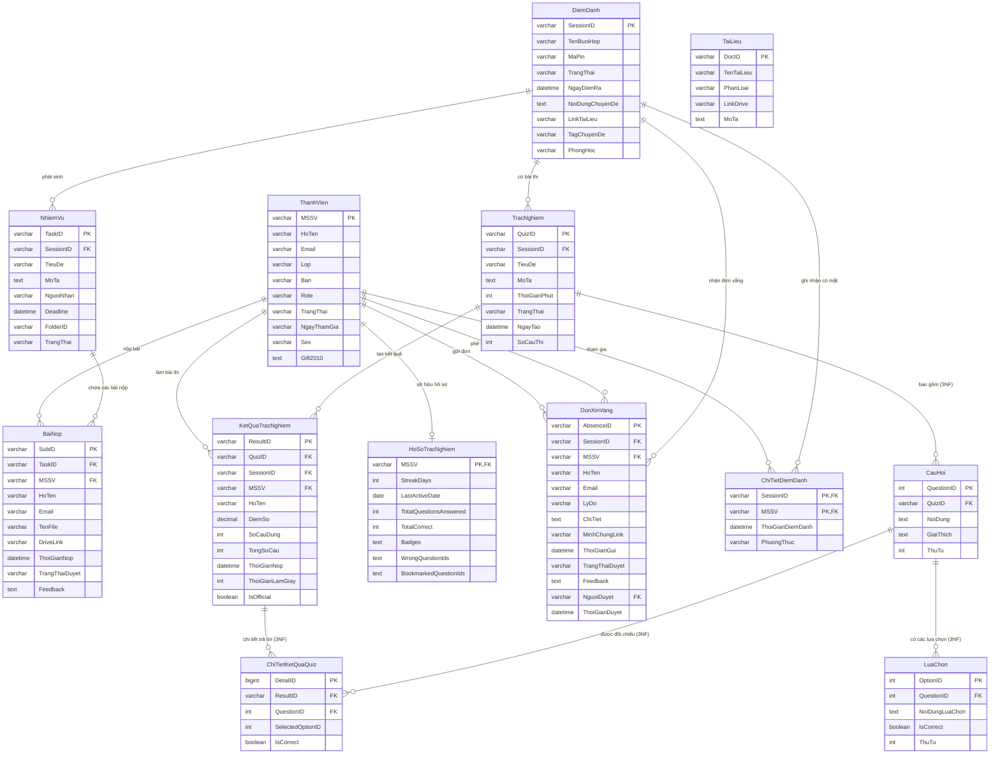

# ĐẶC TẢ CƠ SỞ DỮ LIỆU & LƯỢC ĐỒ QUAN HỆ (DATABASE SCHEMA & ERD SPECIFICATION)
> **Dự án:** Cổng Quản Lý Ban Học Thuật – CLB Tin Học VNUF2  
> **Backend hiện tại:** Google Apps Script (Headless JSON API) + Google Sheets (9 Tabs) + PropertiesService  
> **Mục đích tài liệu:** Cung cấp toàn bộ từ điển dữ liệu (Data Dictionary), phân tích quan hệ (Cardinality) và mã nguồn chuẩn hóa để thiết kế lược đồ quan hệ thực thể (ERD - Entity Relationship Diagram) trên các công cụ SQL (MySQL Workbench, Draw.io, DBeaver, dbdiagram.io, dbdocs).

---

## 1. TỔNG QUAN KIẾN TRÚC DỮ LIỆU HIỆN HÀNH

Cơ sở dữ liệu backend hiện tại được tổ chức trên Google Spreadsheet gồm **9 bảng tính (Tabs)**, kết hợp cùng dịch vụ lưu trữ cấu hình **PropertiesService** và thư mục tệp **Google Drive**:

```text
[Google Spreadsheet: 1dfISUGTsbEZ1289jN0i1SDB_MpXdoorgQA14mCttdus]
 ├── 1. ThanhVien          (Quản lý nhân sự, thông tin cá nhân, phân quyền)
 ├── 2. DiemDanh           (Buổi sinh hoạt, chuyên đề học thuật, mã PIN, điểm danh)
 ├── 3. NhiemVu            (Bài tập học thuật, phân công, hạn nộp, thư mục Drive)
 ├── 4. BaiNop             (Bài nộp của sinh viên, link Google Drive, kết quả duyệt)
 ├── 5. TaiLieu            (Kho học liệu, phân loại chuyên đề)
 ├── 6. TracNghiem         (Ngân hàng đề thi trắc nghiệm & câu hỏi)
 ├── 7. KetQuaTracNghiem   (Lịch sử nộp bài, điểm số, thời gian làm bài, bảng xếp hạng)
 ├── 8. HoSoTracNghiem     (Hồ sơ cá nhân, chuỗi ngày streak, ngân hàng câu hỏi sai/đánh dấu)
 └── 9. DonXinVang         (Đơn xin phép vắng mặt buổi sinh hoạt & phê duyệt)

[PropertiesService & ScriptCache]
 ├── Phiên xác thực (Auth Session Tokens - UUID, TTL 30 ngày)
 ├── Mã xác thực OTP (Email OTP - 6 số, TTL 5 phút)
 └── Cấu hình chiến dịch sự kiện (Active Campaign, Email Templates, Schedule Dates)

[Google Drive Folder: 1yeKM77HthrvSuej1Y3b4t4XHYkpJ1sEW]
 └── Thư mục gốc chứa các sub-folder của từng Nhiệm vụ để lưu tệp bài nộp
```

---

## 2. TỪ ĐIỂN DỮ LIỆU CHI TIẾT (DATA DICTIONARY)

Dưới đây là đặc tả chi tiết 9 thực thể đang vận hành trong file Google Sheets backend (`Config.js` -> `SCHEMA_HEADERS`):

### 2.1. Thực thể `ThanhVien` (`members` / `users`)
- **Mục đích:** Quản lý thông tin hồ sơ của toàn bộ thành viên, ban chủ nhiệm và phân quyền hệ thống.
- **Khóa chính (PK):** `MSSV`

| Tên Cột (Sheet) | Tên Chuẩn SQL | Kiểu Dữ Liệu SQL | Ràng Buộc | Ý Nghĩa Nghiệp Vụ |
| :--- | :--- | :--- | :--- | :--- |
| `MSSV` | `mssv` | `VARCHAR(20)` | **PRIMARY KEY**, NOT NULL | Mã số sinh viên VNUF2 (duy nhất, ví dụ: `257480104007`) |
| `HoTen` | `full_name` | `VARCHAR(100)` | NOT NULL | Họ và tên đầy đủ của thành viên |
| `Email` | `email` | `VARCHAR(150)` | UNIQUE, NULLABLE | Email nhận thông báo và mã OTP đăng nhập |
| `Lớp` (`Lop`) | `class_name` | `VARCHAR(50)` | NULLABLE | Lớp niên chế / chuyên ngành (ví dụ: `K70-HTTT`, `K67-CNTT`) |
| `Ban` | `department` | `VARCHAR(100)` | DEFAULT 'Ban học thuật' | Ban hoạt động trong CLB |
| `Role` | `role` | `VARCHAR(20)` | NOT NULL, DEFAULT 'MEMBER' | Vai trò: `'ADMIN'` (Ban chủ nhiệm/Quản trị) hoặc `'MEMBER'` (Thành viên) |
| `TrangThai` | `status` | `VARCHAR(20)` | NOT NULL, DEFAULT 'Active' | Trạng thái: `'Active'` (Đang hoạt động) hoặc `'Inactive'` (Tạm dừng/Đã rời) |
| `NgayThamGia` | `joined_at` | `VARCHAR(50)` / `DATE` | NULLABLE | Ngày gia nhập CLB (định dạng `DD/MM/YYYY`) |
| `Sex` | `gender` | `VARCHAR(10)` | DEFAULT 'male' | Giới tính: `'male'` (Nam) hoặc `'female'` (Nữ) - phục vụ sự kiện 20/10 |
| `Gift2010` | `gift_data` | `TEXT` / `JSON` | NULLABLE | Dữ liệu quà tặng unboxing cá nhân hóa (giftId, claimCode, used...) |

---

### 2.2. Thực thể `DiemDanh` (`attendance_sessions`)
- **Mục đích:** Quản lý các buổi sinh hoạt định kỳ, họp ban và chuyên đề học thuật.
- **Khóa chính (PK):** `SessionID`

| Tên Cột (Sheet) | Tên Chuẩn SQL | Kiểu Dữ Liệu SQL | Ràng Buộc | Ý Nghĩa Nghiệp Vụ |
| :--- | :--- | :--- | :--- | :--- |
| `SessionID` | `session_id` | `VARCHAR(50)` | **PRIMARY KEY**, NOT NULL | Mã định danh buổi học (ví dụ: `MEET_20261015_190000`, `SESSION_GENERAL`) |
| `TenBuoiHop` | `title` | `VARCHAR(255)` | NOT NULL | Tên/Tiêu đề buổi sinh hoạt chuyên đề |
| `MaPin` | `pin_code` | `VARCHAR(10)` | NULLABLE | Mã PIN 6 số phục vụ điểm danh tức thời trong phòng học |
| `TrangThai` | `status` | `VARCHAR(20)` | NOT NULL, DEFAULT 'Closed' | Trạng thái phiên: `'Open'` (Đang mở điểm danh) hoặc `'Closed'` (Đã đóng) |
| `DS_CoMat` | `attendees_json` | `TEXT` / `JSON` | DEFAULT '[]' | Mảng JSON chứa danh sách MSSV đã điểm danh thành công |
| `NgayDienRa` | `session_date` | `VARCHAR(50)` / `DATETIME`| NULLABLE | Thời gian diễn ra buổi họp (ví dụ: `15/10/2026 19:30`) |
| `NoiDungChuyenDe` | `description` | `TEXT` | NULLABLE | Tóm tắt nội dung kiến thức chuyên đề học thuật |
| `LinkTaiLieu` | `document_url` | `VARCHAR(500)` | NULLABLE | Đường dẫn slide/tài liệu đính kèm (Drive, GitHub) |
| `TagChuyenDe` | `category_tag` | `VARCHAR(50)` | DEFAULT 'GENERAL' | Nhãn phân loại: `'GENERAL'`, `'WORD_DO_AN'`, `'EXCEL_DATA'`, `'OLYMPIC'` |
| `PhongHoc` | `location` | `VARCHAR(100)` | NULLABLE | Địa điểm diễn ra (ví dụ: `Phòng Lab 02 - Tòa A3`, `Google Meet`) |

---

### 2.3. Thực thể `NhiemVu` (`tasks`)
- **Mục đích:** Quản lý các bài tập, nhiệm vụ học thuật giao cho thành viên thực hành sau buổi sinh hoạt.
- **Khóa chính (PK):** `TaskID`
- **Khóa ngoại (FK):** `SessionID` -> tham chiếu `DiemDanh.SessionID`

| Tên Cột (Sheet) | Tên Chuẩn SQL | Kiểu Dữ Liệu SQL | Ràng Buộc | Ý Nghĩa Nghiệp Vụ |
| :--- | :--- | :--- | :--- | :--- |
| `TaskID` | `task_id` | `VARCHAR(50)` | **PRIMARY KEY**, NOT NULL | Mã định danh nhiệm vụ (ví dụ: `TASK_20261015_001`) |
| `TieuDe` | `title` | `VARCHAR(255)` | NOT NULL | Tiêu đề bài tập / nhiệm vụ |
| `MoTa` | `description` | `TEXT` | NULLABLE | Yêu cầu chi tiết, thể thức nộp, hướng dẫn kỹ thuật |
| `NguoiNhan` | `assignee_type` | `VARCHAR(50)` | DEFAULT 'ALL' | Đối tượng nhận: `'ALL'` (Tất cả thành viên) hoặc chỉ định cụ thể MSSV |
| `Deadline` | `deadline` | `VARCHAR(50)` / `DATETIME`| NULLABLE | Hạn chót nộp bài (ISO-8601 hoặc `DD/MM/YYYY HH:mm`) |
| `FolderID` | `folder_id` | `VARCHAR(100)` | NULLABLE | ID thư mục Google Drive tự động cấp phát để lưu bài nộp |
| `TrangThai` | `status` | `VARCHAR(20)` | NOT NULL, DEFAULT 'Open' | Trạng thái: `'Open'` (Đang nhận bài) hoặc `'Closed'` (Đã hết hạn/đóng) |
| `SessionID` | `session_id` | `VARCHAR(50)` | **FOREIGN KEY**, NULLABLE | Liên kết với buổi sinh hoạt phát sinh bài tập |

---

### 2.4. Thực thể `BaiNop` (`submissions`)
- **Mục đích:** Lưu trữ lịch sử nộp bài tập của thành viên, liên kết tệp Google Drive và kết quả chấm bài.
- **Khóa chính (PK):** `SubID`
- **Khóa ngoại (FK):**
  - `TaskID` -> tham chiếu `NhiemVu.TaskID`
  - `MSSV` -> tham chiếu `ThanhVien.MSSV`

| Tên Cột (Sheet) | Tên Chuẩn SQL | Kiểu Dữ Liệu SQL | Ràng Buộc | Ý Nghĩa Nghiệp Vụ |
| :--- | :--- | :--- | :--- | :--- |
| `SubID` | `sub_id` | `VARCHAR(50)` | **PRIMARY KEY**, NOT NULL | Mã định danh bài nộp (ví dụ: `SUB_20261015_193000`) |
| `TaskID` | `task_id` | `VARCHAR(50)` | **FOREIGN KEY**, NOT NULL | Mã bài tập được nộp |
| `MSSV` | `mssv` | `VARCHAR(20)` | **FOREIGN KEY**, NOT NULL | Mã số sinh viên người nộp |
| `HoTen` | `student_name` | `VARCHAR(100)` | NULLABLE | Snapshot họ tên sinh viên tại thời điểm nộp bài |
| `Email` | `student_email` | `VARCHAR(150)` | NULLABLE | Snapshot email sinh viên tại thời điểm nộp bài |
| `TenFile` | `file_name` | `VARCHAR(255)` | NOT NULL | Tên tệp tin nộp (chuẩn hóa `[MSSV]_[HoTen]_[TenFile]`) |
| `DriveLink` | `drive_link` | `VARCHAR(500)` | NOT NULL | Đường link trực tiếp đến file trên Google Drive |
| `ThoiGianNop` | `submitted_at` | `VARCHAR(50)` / `DATETIME`| NOT NULL | Thời điểm hoàn tất nộp bài |
| `TrangThaiDuyet`| `review_status` | `VARCHAR(20)` | NOT NULL, DEFAULT 'Pending' | Trạng thái chấm: `'Pending'` (Chờ duyệt), `'Approved'` (Đạt), `'Rejected'` (Không đạt/Cần nộp lại) |
| `Feedback` | `feedback` | `TEXT` | NULLABLE | Lời nhận xét, góp ý và đánh giá chi tiết của người chấm bài |

---

### 2.5. Thực thể `TaiLieu` (`documents`)
- **Mục đích:** Quản lý kho học liệu chung, slide bài giảng, cẩm nang và tài liệu tham khảo của CLB.
- **Khóa chính (PK):** `DocID`

| Tên Cột (Sheet) | Tên Chuẩn SQL | Kiểu Dữ Liệu SQL | Ràng Buộc | Ý Nghĩa Nghiệp Vụ |
| :--- | :--- | :--- | :--- | :--- |
| `DocID` | `doc_id` | `VARCHAR(50)` | **PRIMARY KEY**, NOT NULL | Mã định danh tài liệu (ví dụ: `DOC_WORD_001`, `DOC_MOS_001`) |
| `TenTaiLieu` | `title` | `VARCHAR(255)` | NOT NULL | Tên tài liệu / bài giảng |
| `PhanLoai` | `category` | `VARCHAR(100)` | NOT NULL | Thư mục chuyên môn: `'Word & Khóa luận'`, `'Chuẩn đầu ra (MOS/IC3)'`, `'Prompt AI & Tools'`, `'Excel & Dữ liệu'`, `'Olympic & Thuật toán'` |
| `LinkDrive` | `drive_url` | `VARCHAR(500)` | NOT NULL | Liên kết tải hoặc xem trước tài liệu trên Drive / GitHub |
| `MoTa` | `description` | `TEXT` | NULLABLE | Tóm tắt nội dung và giá trị ứng dụng của tài liệu |

---

### 2.6. Thực thể `TracNghiem` (`quizzes`)
- **Mục đích:** Quản lý các bộ đề thi trắc nghiệm, bài kiểm tra củng cố kiến thức theo buổi sinh hoạt.
- **Khóa chính (PK):** `QuizID`
- **Khóa ngoại (FK):** `SessionID` -> tham chiếu `DiemDanh.SessionID`

| Tên Cột (Sheet) | Tên Chuẩn SQL | Kiểu Dữ Liệu SQL | Ràng Buộc | Ý Nghĩa Nghiệp Vụ |
| :--- | :--- | :--- | :--- | :--- |
| `QuizID` | `quiz_id` | `VARCHAR(50)` | **PRIMARY KEY**, NOT NULL | Mã định danh bộ đề thi (ví dụ: `QUIZ_20261015_01`) |
| `SessionID` | `session_id` | `VARCHAR(50)` | **FOREIGN KEY**, NULLABLE | Buổi học liên kết bộ đề trắc nghiệm |
| `TieuDe` | `title` | `VARCHAR(255)` | NOT NULL | Tiêu đề đề thi / bài ôn luyện |
| `MoTa` | `description` | `TEXT` | NULLABLE | Mô tả phạm vi kiến thức, quy chế thi |
| `ThoiGianPhut` | `duration_minutes` | `INT` | NOT NULL, DEFAULT 10 | Thời gian làm bài chính thức (phút) |
| `TrangThai` | `status` | `VARCHAR(20)` | NOT NULL, DEFAULT 'Draft' | Trạng thái: `'Draft'` (Bản nháp), `'Open'` (Mở thi), `'Closed'` (Đã đóng) |
| `NgayTao` | `created_at` | `VARCHAR(50)` / `DATETIME`| NULLABLE | Thời điểm khởi tạo bộ đề |
| `DanhSachCauHoi`| `questions_json` | `MEDIUMTEXT` / `JSON` | NOT NULL | Mảng JSON chứa danh sách câu hỏi, lựa chọn, đáp án đúng & giải thích |
| `SoCauThi` | `exam_question_limit`| `INT` | DEFAULT 10 | Số câu hỏi bốc ngẫu nhiên khi thành viên bước vào bài thi chính thức |

---

### 2.7. Thực thể `KetQuaTracNghiem` (`quiz_results`)
- **Mục đích:** Lưu trữ lịch sử làm bài thi, điểm số, thời gian làm bài phục vụ bảng xếp hạng (Leaderboard).
- **Khóa chính (PK):** `ResultID`
- **Khóa ngoại (FK):**
  - `QuizID` -> tham chiếu `TracNghiem.QuizID`
  - `SessionID` -> tham chiếu `DiemDanh.SessionID`
  - `MSSV` -> tham chiếu `ThanhVien.MSSV`

| Tên Cột (Sheet) | Tên Chuẩn SQL | Kiểu Dữ Liệu SQL | Ràng Buộc | Ý Nghĩa Nghiệp Vụ |
| :--- | :--- | :--- | :--- | :--- |
| `ResultID` | `result_id` | `VARCHAR(50)` | **PRIMARY KEY**, NOT NULL | Mã định danh kết quả bài thi |
| `QuizID` | `quiz_id` | `VARCHAR(50)` | **FOREIGN KEY**, NOT NULL | Mã bộ đề thi được làm |
| `SessionID` | `session_id` | `VARCHAR(50)` | **FOREIGN KEY**, NULLABLE | Buổi học tương ứng |
| `MSSV` | `mssv` | `VARCHAR(20)` | **FOREIGN KEY**, NOT NULL | Mã số sinh viên nộp bài thi |
| `HoTen` | `student_name` | `VARCHAR(100)` | NULLABLE | Họ tên sinh viên |
| `DiemSo` | `score` | `DECIMAL(5,2)` | NOT NULL, DEFAULT 0.00 | Điểm số đạt được (thang điểm 10 hoặc 100) |
| `SoCauDung` | `correct_count` | `INT` | NOT NULL, DEFAULT 0 | Số lượng câu trả lời đúng |
| `TongSoCau` | `total_count` | `INT` | NOT NULL, DEFAULT 0 | Tổng số câu hỏi của lượt thi |
| `ChiTietTraLoi` | `answers_json` | `TEXT` / `JSON` | NULLABLE | JSON chi tiết phương án sinh viên chọn cho từng câu hỏi |
| `ThoiGianNop` | `submitted_at` | `VARCHAR(50)` / `DATETIME`| NOT NULL | Thời điểm nộp bài trắc nghiệm |
| `ThoiGianLamGiay`| `time_spent_seconds`| `INT` | DEFAULT 0 | Tổng số giây hoàn thành (tiêu chí phụ khi xét cùng điểm trên BXH) |
| `IsOfficial` | `is_official` | `BOOLEAN` / `TINYINT(1)` | DEFAULT TRUE | `true`: Bài thi chính thức (tính Leaderboard); `false`: Lượt tự ôn luyện |

---

### 2.8. Thực thể `HoSoTracNghiem` (`quiz_profiles`)
- **Mục đích:** Quản lý cơ chế Gamification cá nhân hóa, duy trì chuỗi ngày streak ôn tập, huy hiệu và ngân hàng câu hỏi khó cần ôn lại.
- **Khóa chính (PK):** `MSSV`
- **Khóa ngoại (FK):** `MSSV` -> tham chiếu `ThanhVien.MSSV` (Quan hệ 1 - 1)

| Tên Cột (Sheet) | Tên Chuẩn SQL | Kiểu Dữ Liệu SQL | Ràng Buộc | Ý Nghĩa Nghiệp Vụ |
| :--- | :--- | :--- | :--- | :--- |
| `MSSV` | `mssv` | `VARCHAR(20)` | **PRIMARY KEY**, **FOREIGN KEY** | Mã sinh viên sở hữu hồ sơ học tập |
| `StreakDays` | `streak_days` | `INT` | NOT NULL, DEFAULT 0 | Chuỗi ngày liên tục tham gia làm bài / ôn luyện |
| `LastActiveDate` | `last_active_date` | `VARCHAR(50)` / `DATE` | NULLABLE | Ngày hoạt động gần nhất (để tính toán cộng dồn hoặc reset streak) |
| `TotalQuestionsAnswered` | `total_answered` | `INT` | NOT NULL, DEFAULT 0 | Tổng số câu hỏi sinh viên đã luyện tập từ trước đến nay |
| `TotalCorrect` | `total_correct` | `INT` | NOT NULL, DEFAULT 0 | Tổng số câu trả lời chính xác |
| `Badges` | `badges_json` | `TEXT` / `JSON` | DEFAULT '[]' | Danh sách huy hiệu thành tích học thuật đã mở khóa |
| `WrongQuestionIds` | `wrong_ids_json` | `TEXT` / `JSON` | DEFAULT '[]' | Mảng ID các câu hỏi từng làm sai (dùng cho chế độ "Luyện tập câu sai") |
| `BookmarkedQuestionIds`| `bookmarked_ids_json`| `TEXT` / `JSON` | DEFAULT '[]' | Mảng ID các câu hỏi sinh viên tự bấm bookmark lưu lại |

---

### 2.9. Thực thể `DonXinVang` (`absence_requests`)
- **Mục đích:** Tiếp nhận, xét duyệt và lưu trữ đơn xin phép vắng mặt buổi sinh hoạt chuyên đề.
- **Khóa chính (PK):** `AbsenceID`
- **Khóa ngoại (FK):**
  - `SessionID` -> tham chiếu `DiemDanh.SessionID`
  - `MSSV` -> tham chiếu `ThanhVien.MSSV`
  - `NguoiDuyet` -> tham chiếu `ThanhVien.MSSV` (Admin phê duyệt đơn)

| Tên Cột (Sheet) | Tên Chuẩn SQL | Kiểu Dữ Liệu SQL | Ràng Buộc | Ý Nghĩa Nghiệp Vụ |
| :--- | :--- | :--- | :--- | :--- |
| `AbsenceID` | `absence_id` | `VARCHAR(50)` | **PRIMARY KEY**, NOT NULL | Mã định danh đơn xin vắng |
| `SessionID` | `session_id` | `VARCHAR(50)` | **FOREIGN KEY**, NOT NULL | Buổi sinh hoạt xin phép vắng |
| `MSSV` | `mssv` | `VARCHAR(20)` | **FOREIGN KEY**, NOT NULL | Mã sinh viên làm đơn |
| `HoTen` | `student_name` | `VARCHAR(100)` | NULLABLE | Snapshot họ tên sinh viên |
| `Email` | `student_email` | `VARCHAR(150)` | NULLABLE | Snapshot email sinh viên |
| `LyDo` | `reason` | `VARCHAR(255)` | NOT NULL | Lý do tổng quan (Trùng lịch học, Sức khỏe, Việc gia đình...) |
| `ChiTiet` | `details` | `TEXT` | NULLABLE | Trình bày giải trình chi tiết hoàn cảnh |
| `MinhChungLink` | `evidence_link` | `VARCHAR(500)` | NULLABLE | Link ảnh chụp minh chứng (Thời khóa biểu, giấy phép...) |
| `ThoiGianGui` | `submitted_at` | `VARCHAR(50)` / `DATETIME`| NOT NULL | Thời điểm nộp đơn |
| `TrangThaiDuyet`| `approval_status`| `VARCHAR(20)` | NOT NULL, DEFAULT 'Pending' | Trạng thái: `'Pending'` (Chờ duyệt), `'Approved'` (Được phép vắng), `'Rejected'` (Bác đơn), `'Cancelled'` (Sinh viên tự hủy đơn) |
| `Feedback` | `feedback` | `TEXT` | NULLABLE | Ý kiến phản hồi / ghi chú từ Ban Quản trị |
| `NguoiDuyet` | `reviewer_mssv` | `VARCHAR(20)` | **FOREIGN KEY**, NULLABLE | MSSV của Quản trị viên/Ban chủ nhiệm đã duyệt đơn |
| `ThoiGianDuyet` | `reviewed_at` | `VARCHAR(50)` / `DATETIME`| NULLABLE | Thời điểm thực hiện thao tác duyệt |

---

## 3. PHÂN TÍCH CHUẨN HÓA SANG MÔ HÌNH QUAN HỆ 3NF (RELATIONAL 3NF MODEL)

Trong kiến trúc Google Sheets/NoSQL hiện tại, một số trường được lưu dưới dạng chuỗi JSON bán cấu trúc (Denormalized) nhằm tối ưu số lần đọc/ghi dòng trên Sheet. Khi chuyển đổi sang hệ cơ sở dữ liệu quan hệ SQL chuẩn (MySQL, PostgreSQL, MariaDB), các trường này **cần được tách thành các bảng quan hệ độc lập** đạt chuẩn 3NF:

### 3.1. Điểm danh: Chuyển `DS_CoMat` thành Bảng nối nhiều-nhiều `ChiTietDiemDanh`
- **Lý do:** Một sinh viên tham gia nhiều buổi học, một buổi học có nhiều sinh viên có mặt (Quan hệ N - N).
- **Bảng mới:** `ChiTietDiemDanh` (`attendance_records`)
  - `SessionID` (`VARCHAR(50)` - PK, FK tham chiếu `DiemDanh.SessionID`)
  - `MSSV` (`VARCHAR(20)` - PK, FK tham chiếu `ThanhVien.MSSV`)
  - `ThoiGianDiemDanh` (`DATETIME` - Thời điểm bấm check-in PIN hoặc điểm danh thủ công)
  - `PhuongThuc` (`VARCHAR(20)` - `'PIN_CODE'` hoặc `'ADMIN_MANUAL'`)

### 3.2. Trắc nghiệm: Tách `DanhSachCauHoi` thành Bảng `CauHoi` và Bảng `LuaChon`
- **Cấu trúc JSON hiện tại trong mỗi câu hỏi:**
  ```json
  {
    "id": 1,
    "cauHoi": "Nội dung câu hỏi...",
    "luaChon": ["Đáp án A", "Đáp án B", "Đáp án C", "Đáp án D"],
    "dapAnDung": 1,
    "giaiThich": "Giải thích chi tiết kiến thức..."
  }
  ```
- **Bảng chuẩn hóa 1:** `CauHoi` (`quiz_questions`)
  - `QuestionID` (`INT` / `VARCHAR(50)` - PK)
  - `QuizID` (`VARCHAR(50)` - FK tham chiếu `TracNghiem.QuizID`)
  - `NoiDung` (`TEXT` - Nội dung câu hỏi)
  - `GiaiThich` (`TEXT` - Lời giải chi tiết)
  - `ThuTu` (`INT` - Vị trí sắp xếp câu hỏi trong đề)
- **Bảng chuẩn hóa 2:** `LuaChon` (`question_options`)
  - `OptionID` (`INT` / `VARCHAR(50)` - PK)
  - `QuestionID` (`INT` / `VARCHAR(50)` - FK tham chiếu `CauHoi.QuestionID`)
  - `NoiDungLuaChon` (`TEXT` - Văn bản đáp án)
  - `IsCorrect` (`BOOLEAN` - Đánh dấu đáp án chính xác)
  - `ThuTu` (`INT` - Vị trí A, B, C, D)

### 3.3. Kết quả thi: Tách `ChiTietTraLoi` thành Bảng `ChiTietKetQuaQuiz`
- **Bảng mới:** `ChiTietKetQuaQuiz` (`quiz_answer_details`)
  - `DetailID` (`BIGINT` - PK, Auto Increment)
  - `ResultID` (`VARCHAR(50)` - FK tham chiếu `KetQuaTracNghiem.ResultID`)
  - `QuestionID` (`INT` / `VARCHAR(50)` - FK tham chiếu `CauHoi.QuestionID`)
  - `SelectedOptionID` (`INT` / `VARCHAR(50)` - Nullable, phương án sinh viên chọn)
  - `IsCorrect` (`BOOLEAN` - Kết quả đúng hay sai)

### 3.4. Dữ liệu hệ thống ngoài Sheet: Chuyển PropertiesService thành các Bảng SQL
- **Bảng `ChienDich` (`campaigns`):**
  - `CampaignID` (`VARCHAR(50)` - PK, ví dụ: `'OCT20'`, `'TET'`, `'VALENTINE'`)
  - `TieuDe` (`VARCHAR(255)`), `PhuDe` (`VARCHAR(255)`), `DoiTuong` (`VARCHAR(20)` - `'female'`, `'all'`)
  - `NgayBatDau` (`DATETIME`), `NgayKetThuc` (`DATETIME`)
  - `EmailSubject` (`VARCHAR(255)`), `EmailTemplate` (`TEXT`), `IsActive` (`BOOLEAN`)
- **Bảng `PhienXacThuc` (`auth_sessions`):**
  - `Token` (`VARCHAR(100)` - PK, UUID)
  - `MSSV` (`VARCHAR(20)` - FK tham chiếu `ThanhVien.MSSV`)
  - `CreatedAt` (`DATETIME`), `ExpiresAt` (`DATETIME`), `DeviceInfo` (`VARCHAR(255)`)
- **Bảng `MaXacThucOTP` (`auth_otps`):**
  - `OTP_ID` (`BIGINT` - PK, Auto Increment)
  - `MSSV` (`VARCHAR(20)` - FK tham chiếu `ThanhVien.MSSV`)
  - `Email` (`VARCHAR(150)`), `OtpCode` (`VARCHAR(10)`), `ExpiresAt` (`DATETIME`), `IsUsed` (`BOOLEAN`)

---

## 4. MA TRẬN MỐI QUAN HỆ & BẢN SỐ (CARDINALITY MATRIX)

Bảng tổng hợp quan hệ giữa các thực thể cốt lõi phục vụ vẽ lược đồ quan hệ thực thể (ERD):

| Thực Thể 1 (Parent) | Thực Thể 2 (Child) | Mối Quan Hệ | Bản Số (Cardinality) | Khóa Ngoại (Foreign Key) | Ràng Buộc Hành Vi (On Delete / On Update) |
| :--- | :--- | :--- | :--- | :--- | :--- |
| `ThanhVien` | `BaiNop` | 1 - N | 1 : 0..* | `BaiNop.MSSV` -> `ThanhVien.MSSV` | ON UPDATE CASCADE, ON DELETE RESTRICT |
| `ThanhVien` | `KetQuaTracNghiem` | 1 - N | 1 : 0..* | `KetQuaTracNghiem.MSSV` -> `ThanhVien.MSSV` | ON UPDATE CASCADE, ON DELETE CASCADE |
| `ThanhVien` | `HoSoTracNghiem` | 1 - 1 | 1 : 0..1 | `HoSoTracNghiem.MSSV` -> `ThanhVien.MSSV` | ON UPDATE CASCADE, ON DELETE CASCADE |
| `ThanhVien` | `DonXinVang` (Nộp) | 1 - N | 1 : 0..* | `DonXinVang.MSSV` -> `ThanhVien.MSSV` | ON UPDATE CASCADE, ON DELETE RESTRICT |
| `ThanhVien` (Admin)| `DonXinVang` (Duyệt) | 1 - N | 1 : 0..* | `DonXinVang.NguoiDuyet` -> `ThanhVien.MSSV` | ON UPDATE CASCADE, ON DELETE SET NULL |
| `DiemDanh` | `NhiemVu` | 1 - N | 1 : 0..* | `NhiemVu.SessionID` -> `DiemDanh.SessionID` | ON UPDATE CASCADE, ON DELETE SET NULL |
| `DiemDanh` | `TracNghiem` | 1 - N | 1 : 0..* | `TracNghiem.SessionID` -> `DiemDanh.SessionID` | ON UPDATE CASCADE, ON DELETE SET NULL |
| `DiemDanh` | `DonXinVang` | 1 - N | 1 : 0..* | `DonXinVang.SessionID` -> `DiemDanh.SessionID` | ON UPDATE CASCADE, ON DELETE CASCADE |
| `DiemDanh` | `ChiTietDiemDanh` | 1 - N | 1 : 0..* | `ChiTietDiemDanh.SessionID` -> `DiemDanh.SessionID` | ON UPDATE CASCADE, ON DELETE CASCADE |
| `ThanhVien` | `ChiTietDiemDanh` | 1 - N | 1 : 0..* | `ChiTietDiemDanh.MSSV` -> `ThanhVien.MSSV` | ON UPDATE CASCADE, ON DELETE CASCADE |
| `NhiemVu` | `BaiNop` | 1 - N | 1 : 0..* | `BaiNop.TaskID` -> `NhiemVu.TaskID` | ON UPDATE CASCADE, ON DELETE RESTRICT |
| `TracNghiem` | `KetQuaTracNghiem` | 1 - N | 1 : 0..* | `KetQuaTracNghiem.QuizID` -> `TracNghiem.QuizID` | ON UPDATE CASCADE, ON DELETE CASCADE |
| `TracNghiem` | `CauHoi` (3NF) | 1 - N | 1 : 1..* | `CauHoi.QuizID` -> `TracNghiem.QuizID` | ON UPDATE CASCADE, ON DELETE CASCADE |
| `CauHoi` (3NF) | `LuaChon` (3NF) | 1 - N | 1 : 2..* | `LuaChon.QuestionID` -> `CauHoi.QuestionID` | ON UPDATE CASCADE, ON DELETE CASCADE |

---

## 5. LƯỢC ĐỒ QUAN HỆ THỰC THỂ (MERMAID ERD DIAGRAM)

Bạn có thể copy trực tiếp đoạn mã Mermaid dưới đây vào bất kỳ công cụ nào hỗ trợ Markdown Mermaid (Notion, Draw.io, GitHub, Mermaid Live Editor, Obsidian) để render sơ đồ quan hệ:



---

## 6. MÃ NGUỒN TẠO BẢNG DDL SQL (SQL SCHEMA SCRIPT)

Dưới đây là tập lệnh DDL SQL hoàn chỉnh (ANSI SQL / MySQL 8.0+ / MariaDB) với đầy đủ khóa chính, khóa ngoại, kiểu dữ liệu, ràng buộc toàn vẹn và chỉ mục (Index) hỗ trợ truy vấn hiệu năng cao:

```sql
-- ====================================================================
-- CƠ SỞ DỮ LIỆU BAN HỌC THUẬT CLB TIN HỌC VNUF2
-- Hệ quản trị CSDL đề xuất: MySQL 8.0+ / MariaDB / PostgreSQL
-- ====================================================================

-- 1. BẢNG THÀNH VIÊN & PHÂN QUYỀN
CREATE TABLE `thanh_vien` (
    `mssv` VARCHAR(20) NOT NULL COMMENT 'Mã số sinh viên (Khóa chính)',
    `ho_ten` VARCHAR(100) NOT NULL COMMENT 'Họ và tên thành viên',
    `email` VARCHAR(150) NULL UNIQUE COMMENT 'Email nhận OTP và thông báo',
    `lop` VARCHAR(50) NULL COMMENT 'Lớp sinh hoạt / chuyên ngành',
    `ban` VARCHAR(100) NOT NULL DEFAULT 'Ban học thuật',
    `role` ENUM('ADMIN', 'MEMBER') NOT NULL DEFAULT 'MEMBER',
    `trang_thai` ENUM('Active', 'Inactive') NOT NULL DEFAULT 'Active',
    `ngay_tham_gia` VARCHAR(50) NULL,
    `sex` ENUM('male', 'female') NOT NULL DEFAULT 'male',
    `gift_data` JSON NULL COMMENT 'Thông tin quà tặng 20/10 hoặc sự kiện',
    PRIMARY KEY (`mssv`),
    INDEX `idx_thanhvien_role` (`role`),
    INDEX `idx_thanhvien_email` (`email`)
) ENGINE=InnoDB DEFAULT CHARSET=utf8mb4 COLLATE=utf8mb4_unicode_ci;

-- 2. BẢNG BUỔI SINH HOẠT & CHUYÊN ĐỀ
CREATE TABLE `diem_danh` (
    `session_id` VARCHAR(50) NOT NULL COMMENT 'Mã buổi học (vd: MEET_20261015_190000)',
    `ten_buoi_hop` VARCHAR(255) NOT NULL COMMENT 'Tiêu đề buổi sinh hoạt',
    `ma_pin` VARCHAR(10) NULL COMMENT 'Mã PIN 6 số điểm danh',
    `trang_thai` ENUM('Open', 'Closed') NOT NULL DEFAULT 'Closed',
    `ngay_dien_ra` VARCHAR(50) NULL COMMENT 'Thời gian tổ chức',
    `noi_dung_chuyen_de` TEXT NULL,
    `link_tai_lieu` VARCHAR(500) NULL,
    `tag_chuyen_de` VARCHAR(50) NOT NULL DEFAULT 'GENERAL',
    `phong_hoc` VARCHAR(100) NULL,
    PRIMARY KEY (`session_id`),
    INDEX `idx_diemdanh_status` (`trang_thai`)
) ENGINE=InnoDB DEFAULT CHARSET=utf8mb4 COLLATE=utf8mb4_unicode_ci;

-- 2.1. BẢNG CHI TIẾT ĐIỂM DANH (CHUẨN HÓA 3NF TỪ DS_CoMat)
CREATE TABLE `chi_tiet_diem_danh` (
    `session_id` VARCHAR(50) NOT NULL,
    `mssv` VARCHAR(20) NOT NULL,
    `thoi_gian_diem_danh` DATETIME NOT NULL DEFAULT CURRENT_TIMESTAMP,
    `phuong_thuc` ENUM('PIN_CODE', 'ADMIN_MANUAL') NOT NULL DEFAULT 'PIN_CODE',
    PRIMARY KEY (`session_id`, `mssv`),
    CONSTRAINT `fk_ctdd_session` FOREIGN KEY (`session_id`) REFERENCES `diem_danh` (`session_id`) ON DELETE CASCADE ON UPDATE CASCADE,
    CONSTRAINT `fk_ctdd_member` FOREIGN KEY (`mssv`) REFERENCES `thanh_vien` (`mssv`) ON DELETE CASCADE ON UPDATE CASCADE
) ENGINE=InnoDB DEFAULT CHARSET=utf8mb4 COLLATE=utf8mb4_unicode_ci;

-- 3. BẢNG BÀI TẬP / NHIỆM VỤ HỌC THUẬT
CREATE TABLE `nhiem_vu` (
    `task_id` VARCHAR(50) NOT NULL,
    `session_id` VARCHAR(50) NULL,
    `tieu_de` VARCHAR(255) NOT NULL,
    `mo_ta` TEXT NULL,
    `nguoi_nhan` VARCHAR(50) NOT NULL DEFAULT 'ALL',
    `deadline` VARCHAR(50) NULL,
    `folder_id` VARCHAR(100) NULL COMMENT 'Google Drive Folder ID',
    `trang_thai` ENUM('Open', 'Closed') NOT NULL DEFAULT 'Open',
    PRIMARY KEY (`task_id`),
    CONSTRAINT `fk_task_session` FOREIGN KEY (`session_id`) REFERENCES `diem_danh` (`session_id`) ON DELETE SET NULL ON UPDATE CASCADE
) ENGINE=InnoDB DEFAULT CHARSET=utf8mb4 COLLATE=utf8mb4_unicode_ci;

-- 4. BẢNG BÀI NỘP CỦA THÀNH VIÊN
CREATE TABLE `bai_nop` (
    `sub_id` VARCHAR(50) NOT NULL,
    `task_id` VARCHAR(50) NOT NULL,
    `mssv` VARCHAR(20) NOT NULL,
    `ho_ten` VARCHAR(100) NULL,
    `email` VARCHAR(150) NULL,
    `ten_file` VARCHAR(255) NOT NULL,
    `drive_link` VARCHAR(500) NOT NULL,
    `thoi_gian_nop` VARCHAR(50) NOT NULL,
    `trang_thai_duyet` ENUM('Pending', 'Approved', 'Rejected') NOT NULL DEFAULT 'Pending',
    `feedback` TEXT NULL,
    PRIMARY KEY (`sub_id`),
    CONSTRAINT `fk_sub_task` FOREIGN KEY (`task_id`) REFERENCES `nhiem_vu` (`task_id`) ON DELETE RESTRICT ON UPDATE CASCADE,
    CONSTRAINT `fk_sub_member` FOREIGN KEY (`mssv`) REFERENCES `thanh_vien` (`mssv`) ON DELETE RESTRICT ON UPDATE CASCADE,
    INDEX `idx_sub_task_mssv` (`task_id`, `mssv`)
) ENGINE=InnoDB DEFAULT CHARSET=utf8mb4 COLLATE=utf8mb4_unicode_ci;

-- 5. BẢNG KHO TÀI LIỆU HỌC THUẬT
CREATE TABLE `tai_lieu` (
    `doc_id` VARCHAR(50) NOT NULL,
    `ten_tai_lieu` VARCHAR(255) NOT NULL,
    `phan_loai` VARCHAR(100) NOT NULL,
    `link_drive` VARCHAR(500) NOT NULL,
    `mo_ta` TEXT NULL,
    PRIMARY KEY (`doc_id`),
    INDEX `idx_tailieu_phanloai` (`phan_loai`)
) ENGINE=InnoDB DEFAULT CHARSET=utf8mb4 COLLATE=utf8mb4_unicode_ci;

-- 6. BẢNG BỘ ĐỀ TRẮC NGHIỆM
CREATE TABLE `trac_nghiem` (
    `quiz_id` VARCHAR(50) NOT NULL,
    `session_id` VARCHAR(50) NULL,
    `tieu_de` VARCHAR(255) NOT NULL,
    `mo_ta` TEXT NULL,
    `thoi_gian_phut` INT NOT NULL DEFAULT 10,
    `trang_thai` ENUM('Draft', 'Open', 'Closed') NOT NULL DEFAULT 'Draft',
    `ngay_tao` VARCHAR(50) NULL,
    `danh_sach_cau_hoi` MEDIUMTEXT NULL COMMENT 'Lưu dạng JSON hoặc tham chiếu qua bảng câu hỏi',
    `so_cau_thi` INT NOT NULL DEFAULT 10,
    PRIMARY KEY (`quiz_id`),
    CONSTRAINT `fk_quiz_session` FOREIGN KEY (`session_id`) REFERENCES `diem_danh` (`session_id`) ON DELETE SET NULL ON UPDATE CASCADE
) ENGINE=InnoDB DEFAULT CHARSET=utf8mb4 COLLATE=utf8mb4_unicode_ci;

-- 7. BẢNG KẾT QUẢ THI TRẮC NGHIỆM
CREATE TABLE `ket_qua_trac_nghiem` (
    `result_id` VARCHAR(50) NOT NULL,
    `quiz_id` VARCHAR(50) NOT NULL,
    `session_id` VARCHAR(50) NULL,
    `mssv` VARCHAR(20) NOT NULL,
    `ho_ten` VARCHAR(100) NULL,
    `diem_so` DECIMAL(5,2) NOT NULL DEFAULT 0.00,
    `so_cau_dung` INT NOT NULL DEFAULT 0,
    `tong_so_cau` INT NOT NULL DEFAULT 0,
    `chi_tiet_tra_loi` MEDIUMTEXT NULL COMMENT 'JSON chi tiết lựa chọn của sinh viên',
    `thoi_gian_nop` VARCHAR(50) NOT NULL,
    `thoi_gian_lam_giay` INT NOT NULL DEFAULT 0,
    `is_official` BOOLEAN NOT NULL DEFAULT TRUE,
    PRIMARY KEY (`result_id`),
    CONSTRAINT `fk_res_quiz` FOREIGN KEY (`quiz_id`) REFERENCES `trac_nghiem` (`quiz_id`) ON DELETE CASCADE ON UPDATE CASCADE,
    CONSTRAINT `fk_res_session` FOREIGN KEY (`session_id`) REFERENCES `diem_danh` (`session_id`) ON DELETE SET NULL ON UPDATE CASCADE,
    CONSTRAINT `fk_res_member` FOREIGN KEY (`mssv`) REFERENCES `thanh_vien` (`mssv`) ON DELETE CASCADE ON UPDATE CASCADE,
    INDEX `idx_res_leaderboard` (`quiz_id`, `is_official`, `diem_so` DESC, `thoi_gian_lam_giay` ASC)
) ENGINE=InnoDB DEFAULT CHARSET=utf8mb4 COLLATE=utf8mb4_unicode_ci;

-- 8. BẢNG HỒ SƠ GAMIFICATION & ÔN LUYỆN CÁ NHÂN
CREATE TABLE `ho_so_trac_nghiem` (
    `mssv` VARCHAR(20) NOT NULL,
    `streak_days` INT NOT NULL DEFAULT 0,
    `last_active_date` VARCHAR(50) NULL,
    `total_questions_answered` INT NOT NULL DEFAULT 0,
    `total_correct` INT NOT NULL DEFAULT 0,
    `badges` JSON NULL,
    `wrong_question_ids` JSON NULL,
    `bookmarked_question_ids` JSON NULL,
    PRIMARY KEY (`mssv`),
    CONSTRAINT `fk_profile_member` FOREIGN KEY (`mssv`) REFERENCES `thanh_vien` (`mssv`) ON DELETE CASCADE ON UPDATE CASCADE
) ENGINE=InnoDB DEFAULT CHARSET=utf8mb4 COLLATE=utf8mb4_unicode_ci;

-- 9. BẢNG ĐƠN XIN VẮNG BUỔI SINH HOẠT
CREATE TABLE `don_xin_vang` (
    `absence_id` VARCHAR(50) NOT NULL,
    `session_id` VARCHAR(50) NOT NULL,
    `mssv` VARCHAR(20) NOT NULL,
    `ho_ten` VARCHAR(100) NULL,
    `email` VARCHAR(150) NULL,
    `ly_do` VARCHAR(255) NOT NULL,
    `chi_tiet` TEXT NULL,
    `minh_chung_link` VARCHAR(500) NULL,
    `thoi_gian_gui` VARCHAR(50) NOT NULL,
    `trang_thai_duyet` ENUM('Pending', 'Approved', 'Rejected', 'Cancelled') NOT NULL DEFAULT 'Pending',
    `feedback` TEXT NULL,
    `nguoi_duyet` VARCHAR(20) NULL COMMENT 'MSSV của Admin duyệt',
    `thoi_gian_duyet` VARCHAR(50) NULL,
    PRIMARY KEY (`absence_id`),
    CONSTRAINT `fk_abs_session` FOREIGN KEY (`session_id`) REFERENCES `diem_danh` (`session_id`) ON DELETE CASCADE ON UPDATE CASCADE,
    CONSTRAINT `fk_abs_member` FOREIGN KEY (`mssv`) REFERENCES `thanh_vien` (`mssv`) ON DELETE RESTRICT ON UPDATE CASCADE,
    CONSTRAINT `fk_abs_reviewer` FOREIGN KEY (`nguoi_duyet`) REFERENCES `thanh_vien` (`mssv`) ON DELETE SET NULL ON UPDATE CASCADE,
    INDEX `idx_abs_session_status` (`session_id`, `trang_thai_duyet`)
) ENGINE=InnoDB DEFAULT CHARSET=utf8mb4 COLLATE=utf8mb4_unicode_ci;
```

---

## 7. GỢI Ý CÁCH SỬ DỤNG TÀI LIỆU ĐỂ VẼ ERD TRÊN CÁC CÔNG CỤ

1. **Vẽ tự động trên [dbdiagram.io](https://dbdiagram.io):**
   - Mở dbdiagram.io -> Nhấp **Import** -> Chọn **Import from MySQL Script** -> Dán toàn bộ mã SQL ở **Mục 6** -> Hệ thống sẽ tự động vẽ toàn bộ bảng và đường nối quan hệ Foreign Key 100%.
2. **Vẽ trên Draw.io / Diagrams.net:**
   - Vào Draw.io -> Menu **Arrange** -> **Insert** -> **Advanced** -> **SQL...** -> Dán đoạn mã SQL ở **Mục 6** -> Chọn **Insert** để tự động sinh hộp thực thể Entity.
3. **Hiển thị trực quan trong Notion / Markdown:**
   - Copy khối mã `mermaid` ở **Mục 5** và dán vào khối `/code (mermaid)` trong Notion hoặc Markdown previewer.
4. **Nhập vào công cụ quản trị Database (DBeaver / DataGrip / MySQL Workbench):**
   - Chạy script SQL ở **Mục 6** trên một database rỗng -> Mở tính năng **View Diagram / Reverse Engineer ERD** có sẵn của phần mềm để xuất ảnh PNG/PDF/SVG độ phân giải cao.
