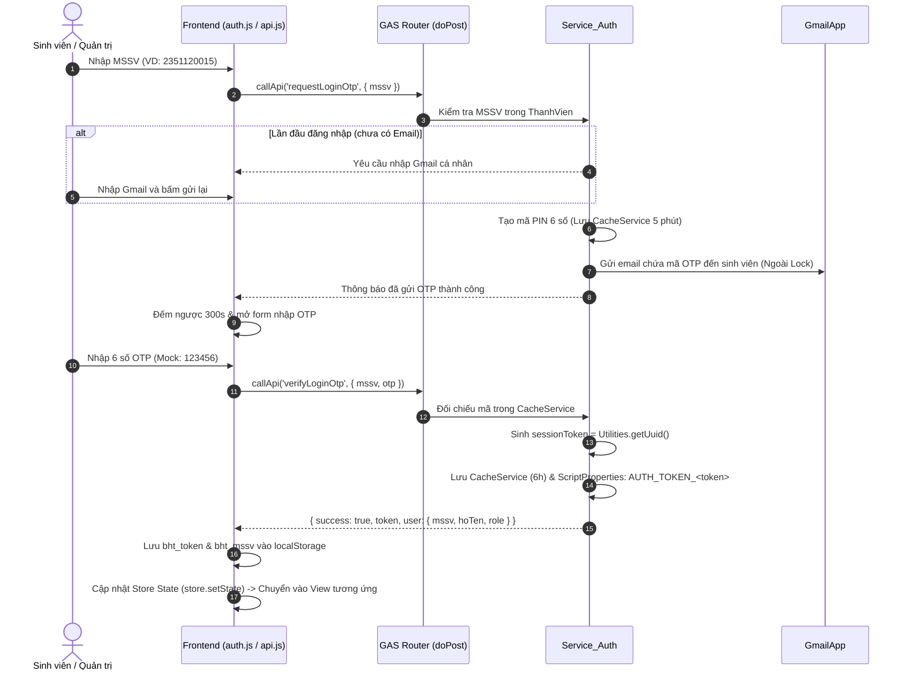
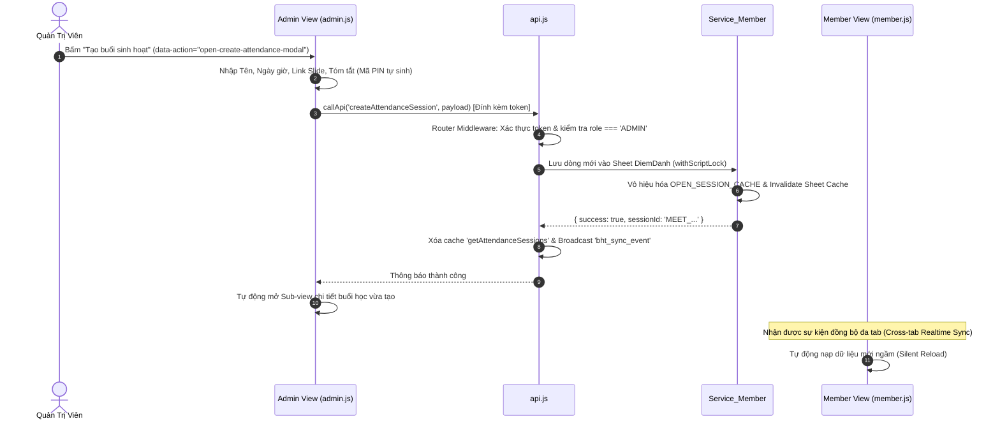
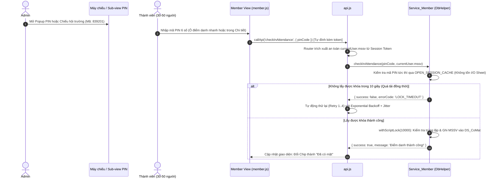

# QUY TRÌNH & LUỒNG XỬ LÝ NGHIỆP VỤ HỆ THỐNG (`xl.md`)
> **Tài liệu đặc tả các luồng dữ liệu (Data Flows) và quy trình xử lý nghiệp vụ giữa Giao diện người dùng (Frontend) và Máy chủ (Backend).**

---

## 1. Sơ Đồ Kiến Trúc Kết Nối Tổng Quan

```
[ Frontend: GitHub Pages / Localhost ]
         │
         │ (HTTP POST với Content-Type: text/plain;charset=utf-8)
         │ Body: { action, token, payload }
         ▼
[ Google Apps Script Web App Router: doPost(e) ]
         │
         ├── Middleware Token-Based Auth & Role Guard
         │
         ├── DbHelper.js        ──> Sheet Batch I/O + Server CacheService + withScriptLock
         ├── Service_Auth       ──> CacheService (OTP 5p, Token 6h) / GmailApp
         ├── Service_Member     ──> OPEN_SESSION_CACHE / Sheet: ThanhVien, DiemDanh
         ├── Service_Task       ──> Sheet: NhiemVu + Google Drive (Tạo Folder ngoài lock)
         └── Service_Submit     ──> Google Drive (Tạo File ngoài lock) + Sheet: BaiNop (Micro-lock)
```

---

## 2. Luồng Xử Lý 1: Đăng Nhập Xác Thực OTP Cấp Token (Zero-Password Auth)



---

## 3. Luồng Xử Lý 2: Quản Lý Buổi Học & Chuyên Đề (Master-Detail)



---

## 4. Luồng Xử Lý 3: Điểm Danh Buổi Học Bằng Mã PIN Tốc Độ Cao



---

## 5. Luồng Xử Lý 4: Giao Bài Tập & Nộp/Chấm Bài Thực Hành (Tối Ưu Drive & Lock)

1. **Giao bài tập (Admin):**
   - Trong Sub-view Chi tiết buổi học, Admin mở tab **"Bài tập & Chấm bài"**.
   - Điền Tiêu đề, Hạn nộp (Deadline), Mô tả định dạng nộp.
   - Bấm **"Lưu & Giao bài tập"** ➔ `callApi('createTask', { ..., sessionId })`.
   - Backend gọi `DriveApp.createFolder()` **ngoài lock**, sau đó ghi thông tin vào sheet `NhiemVu` trong lock ngắn và gắn liên kết `SessionID`.

2. **Nộp bài tập (Member - Tối ưu tải cao):**
   - Thành viên mở Chi tiết Chuyên đề, bấm nút **"Nộp bài ngay"** (`data-action="open-submit-modal"`).
   - Chọn tệp mã nguồn hoặc báo cáo (PDF, ZIP, IPYNB...).
   - `FileReader` đọc tệp và chuyển đổi sang chuỗi **Base64**.
   - Frontend kích hoạt `withButtonLock()` khóa nút và gọi `callApi('submitTaskAssignment', { taskId, fileName, base64Data })`.
   - **Xử lý Backend:**
     - Router tự động gắn `currentUser.mssv`, `currentUser.hoTen`, `currentUser.email` từ token.
     - **Tạo file trên Google Drive NGOÀI KHÓA SCRIPT LOCK** bằng `targetFolder.createFile(blob)`.
     - Sau khi có URL file Drive thành công, chỉ mở `withScriptLock(10000)` trong vài mili-giây để ghi 1 dòng vào sheet `BaiNop`.
   - Backend nhả khóa ngay lập tức và trả về kết quả thành công.

3. **Chấm & Duyệt bài (Admin):**
   - Danh sách bài nộp hiển thị ngay trong tab Bài tập của Buổi học đó.
   - Admin bấm **"Đạt"** (`Approved`) hoặc **"Yêu cầu sửa"** (`Rejected`) kèm nhận xét ➔ `callApi('reviewSubmission', { subId, trangThaiDuyet, feedback })`.

---

## 6. Luồng Xử Lý 5: Cơ Chế Cache Stale-While-Revalidate & Auto-Retry với Jitter

Để đảm bảo hệ thống mở tức thì trong 0.1s và không sập khi 30–50 người cùng thao tác:

1. **Đọc dữ liệu (Query Actions):**
   - Khi gọi `getAttendanceSessions`, `getAllTasks`, `getAllMembers`...
   - Hệ thống kiểm tra cache `bht_cache_[action]_[payload]` trong `localStorage`.
   - **Nếu có cache:** Trả về ngay lập tức để render UI không độ trễ, đồng thời kích hoạt request ngầm cập nhật lại cache.
   - **Nếu không có hoặc hết hạn 10 phút:** Gửi HTTP request đến Google Apps Script.

2. **Cơ chế Auto-Retry với Exponential Backoff & Jitter khi gặp nghẽn:**
   - Khi Backend phản hồi mã lỗi `LOCK_TIMEOUT` hoặc `SERVER_BUSY`, `api.js` tự động thử lại tối đa 4 lần.
   - Khoảng cách chờ:
     $$\text{delay} = \text{baseDelay} \times 2^{\text{attempt}} + \text{randomJitter}(0 \text{--} 1000\text{ms})$$
   - Giúp phân tán đều áp lực lên máy chủ Google Apps Script.

3. **Ghi dữ liệu (Mutation Actions & Cache Invalidation):**
   - Khi thực hiện bất kỳ thao tác thay đổi nào:
     - `createAttendanceSession`, `updateAttendanceTopic`, `toggleAttendanceSession`, `checkInAttendance` ➔ Xóa cache `getAttendanceSessions`.
     - `createTask`, `toggleTaskStatus` ➔ Xóa cache `getAllTasks` và `getAttendanceSessions`.
     - `submitTaskAssignment`, `reviewSubmission` ➔ Xóa cache `getAllSubmissions`, `getMemberSubmissions`.
     - `addMember`, `toggleMemberStatus`, `resetMemberEmail` ➔ Xóa cache `getAllMembers`.
   - Khi người dùng bấm **"Đăng xuất"**, toàn bộ cache dữ liệu và `bht_token` bị xóa sạch hoàn toàn.

---

## 7. Luồng Xử Lý 6: Kiểm Thử Đa Trình Duyệt & Dev Helper

1. **Cơ chế cách ly của Cửa sổ Ẩn danh (Incognito Isolation):**
   - Ở chế độ Mock Data, dữ liệu được bọc an toàn qua `safeStorage` (có `memoryStore` dự phòng).
   - Để hỗ trợ kiểm thử giữa 2 vai trò Admin và Member:
     - **Cách tối ưu nhất:** Dùng nút **`[Xem quyền Member]` / `[Xem quyền Admin]`** trên thanh Dev Helper dưới góc màn hình để chuyển đổi vai trò 1-click ngay trên cùng cửa sổ.
     - **Nếu dùng Cửa sổ Ẩn danh:** Bấm **`Copy Mock`** ở Admin ➔ Sang cửa sổ Ẩn danh bấm **`Dán Mock`** để đồng bộ tức thì.
2. **Khi chuyển sang Google Apps Script thật:**
   - Bấm nút **`[Đổi sang API]`** trên thanh Dev Helper.
   - Mọi máy tính, điện thoại và cửa sổ ẩn danh đều giao tiếp chung qua Google Sheets tập trung với cơ chế bảo vệ Script Lock và Token-Based Auth hoàn chỉnh.
